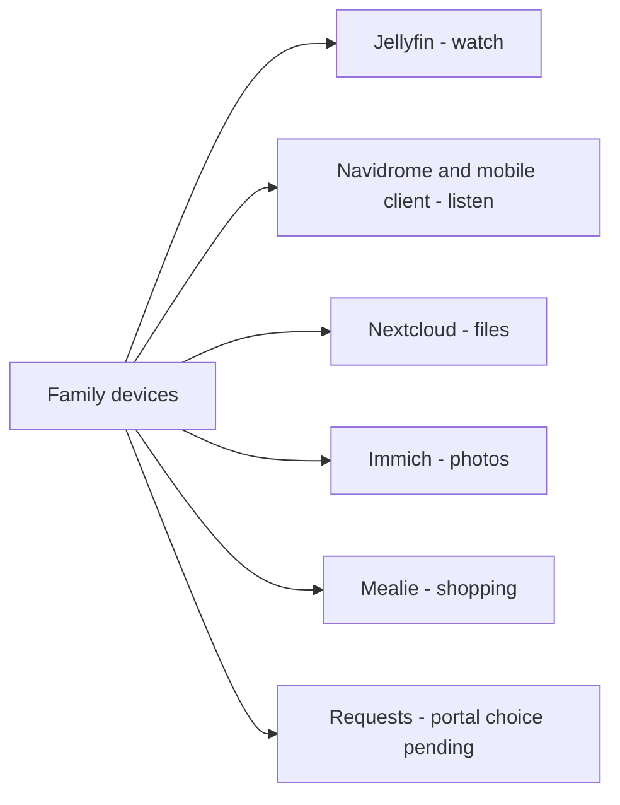
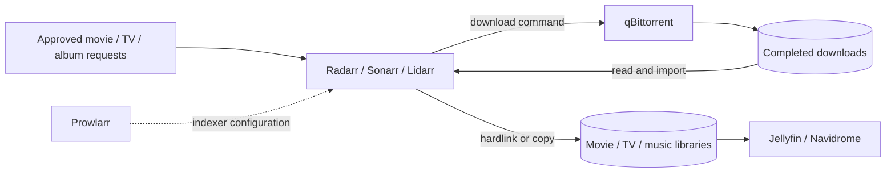
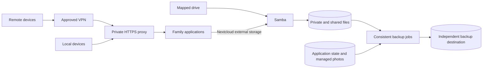

# FamilyHub architecture review

Version 0.3 proposed. 8 November 2026. Awaiting owner approval.

Independent reviews are complete: [Astra](REVIEW_ASTRA.md) and [Opus](REVIEW_OPUS.md), both at medium effort. Read [the comparison and proposed revisions](REVIEW_COMPARISON.md) for agreements, disagreements and corrections. The smaller diagrams below replace the original combined graph. Service substitutions remain proposals requiring owner selection.

This document plans a family server and a later installable FOSS integration platform. Automatic torrent downloads for movies, television and music are included in the proposed private deployment. No installation, application deployment or production code is authorized by this review.

Evidence labels used below are **Verified** for upstream documentation or source, **Proposed** for architecture choices, and **Unverified** for behavior that requires testing. Upstream capabilities do not establish that this hardware or a particular client passes acceptance tests.

## 1. Recommendation and assumptions

Use Debian 13, Docker Engine and Compose on one host. Run independent application modules with explicit storage permissions, separate application databases, a private reverse proxy, and off-host backups. Keep the initial family interface as links to mature applications. Add only small orchestration components when a documented gap requires them.

The core media stack should be Jellyfin, Navidrome and Substreamer. Add Seerr, Radarr, Sonarr, Bazarr, Prowlarr, qBittorrent and **Lidarr** for automatic acquisition. Seerr handles movie and television requests; music acquisition has a separate request boundary. Navidrome remains the music player and library server.

The owner confirmed **4–6 family members** on 8 November 2026. Other ranges lost punctuation in the supplied brief. Planning assumptions requiring confirmation are 4–6 VM vCPUs, 8–12 GB VM memory, a 100–200 GB VM disk, a 400–550 W PSU, future 4–10 TB HDDs, a 23:00–07:00 download window, 7–30 days for watched temporary media and 30–90 days for unwatched temporary media.

Start development with 6 vCPUs, 12 GB RAM and a 200 GB dynamically expanding Linux disk. Use a separate 16 GB validation profile for the full suite. Store databases inside the Linux filesystem, never a Windows shared folder. Hyper-V is the first candidate if the installed Windows edition supports it; otherwise select an available hypervisor after checking workstation capabilities. VM networking must allow phone and TV tests without exposing services beyond the intended LAN.

**Verified:** Debian 13 is the current stable Debian release. [Debian releases](https://www.debian.org/releases/).

## 2. Architecture and dependency map

Each view answers one question. A service appearing in different views is the same deployment. Databases and detailed dependencies remain in the table, rather than adding them to every diagram. Arrows show access or data relationships, not unrestricted network reachability.

### What does the family open?

This view preserves the selected applications while the consolidation proposals are reviewed. Requests means Seerr for video plus an unresolved music request route; Ombi is the proposed single-portal trial in section 6.



### How does media arrive?

Managers issue download commands and import completed files. Import is an action performed by those managers, not another service. Prowlarr supplies indexer configuration. Request status and subsequent library scans are omitted from this view.



### How are private services and data protected?

Host backup jobs capture consistent recovery sets; this box represents an operation, not another always-running application. Internet-facing administration remains disabled.



| Module | Required dependencies | Failure boundary |
|---|---|---|
| Jellyfin | Its state, media mounts; iGPU for accelerated transcodes | Existing local playback works with acquisition services stopped |
| Navidrome | Its database and read-only music library | Music works without Lidarr, MusicBrainz or external recommendations |
| Seerr | Jellyfin connection; Radarr/Sonarr for acquisition | Requests may wait while playback continues |
| Radarr/Sonarr/Lidarr | Their own state, configured indexers, qBittorrent and media paths | No access to family documents or photos |
| Bazarr | Radarr/Sonarr APIs, subtitle sources and video paths | Subtitle failures do not stop already playable media |
| Nextcloud | Dedicated database, supported locking cache, cron, private data; Samba for external shares | External share failure must not corrupt Nextcloud's own storage |
| Immich | Its version-matched database/cache and managed asset storage | ML is optional; photo service has its own recovery unit |
| Mealie | Its own database and assets | Independent of media and file services |
| Homepage | Static service configuration | Dashboard failure does not stop direct app access |

Prowlarr synchronizes indexer configuration into the managers. It does not carry downloaded media bytes. Databases listen only on their application networks.

## 3. Stack, alternatives and tradeoffs

All selections remain proposed until approval. Pin exact supported versions during the proof of concept.

| Area | Recommendation | Alternative and tradeoff |
|---|---|---|
| Host | Debian 13 minimal, systemd | Ubuntu Server LTS if a demonstrated driver issue warrants it |
| Runtime | Docker Engine plus Compose | Podman adds compatibility work; Kubernetes adds administration without a single-host benefit |
| Filesystem | LVM plus ext4, modest free VG capacity if practical | Btrfs adds snapshots/checksums but more operational knowledge; snapshots still require independent backups |
| Reverse proxy | Caddy, explicit per-app hostnames | Nginx is viable; Traefik adds dynamic discovery that this installation does not need |
| Movies/TV | Jellyfin plus Seerr and optional managers | Keep TV playback and phone/web requests separate for release one |
| Music | Navidrome plus Substreamer | Other FOSS OpenSubsonic clients after offline/background playback tests |
| Acquisition | qBittorrent, Prowlarr, Radarr/Sonarr and Lidarr | Manual import remains available; defer autobrr until a source requires announcement-driven automation |
| Files | Nextcloud plus host Samba | WebDAV mapping can avoid SMB integration, but does not replace the requested SMB acceptance test |
| Photos | Immich with ML initially disabled or scheduled | Nextcloud-only photo backup has fewer components but gives up the selected photo experience |
| Lists | Mealie for household lists | Evaluate a dedicated FOSS list app only if overlapping membership is required |
| Dashboard | Family Homepage with static links | Separate administrator entry point; custom PWA deferred |
| Monitoring | Uptime Kuma, smartmontools, lightweight host metrics, rotated logs | Prometheus/Grafana later if retained metric history justifies them |
| Backups | Restic to a physically independent destination | Borg is a reasonable alternative with a suitable SSH destination |
| Identity | Native per-app accounts and a provisioning checklist | Authentik/Authelia later after client compatibility and resource tests |

**Verified:** Seerr documents Jellyfin integration and Radarr/Sonarr workflows. Do not treat it as a verified Lidarr music request interface. [Seerr](https://seerr.dev/).

**Verified:** Substreamer's upstream project declares GPLv3, Android/iOS clients, background playback and offline album/playlist downloads. Its README also notes that some history and metadata are stored locally on the phone. Server backup alone therefore does not preserve every client-specific preference. [Substreamer source](https://github.com/ghenry22/substreamer).

**Verified:** Navidrome supports libraries with user-specific access controls. Use one shared collection initially, with optional private libraries later. Recommendations start with library browsing, favorites and playlists; similarity ML remains optional. [Navidrome library support](https://www.navidrome.org/docs/usage/features/multi-library/).

## 4. Docker, networking and TLS

Proposed Compose modules are base, playback, acquisition, files, photos and collaboration. Each module includes its own mandatory dependencies. Explicit module selection must not accidentally start acquisition services. Resolve and validate the combined Compose configuration in CI. Keep development and production overlays small and exclude secret values from Git.

Use separate bridge networks for each application and its database. Connect the reverse proxy only to the application frontends it needs. Acquisition services get their own network and outbound connectivity. Membership in a shared network is a trust decision. Restrict application-to-application access with network separation and narrow proxy/firewall rules where needed.

Expose only the proxy on intended LAN/VPN addresses. Host Samba listens on LAN TCP 445, with VPN SMB optional and explicitly restricted. SSH uses keys from administrator devices only. Database ports, torrent WebUI, manager UIs, monitoring and Docker API stay inaccessible to ordinary family devices. Torrent peer traffic is a distinct optional port decision; disable automatic UPnP/NAT-PMP router changes by default. No HTTP admin service is port-forwarded.

Docker-published ports can bypass ordinary UFW expectations. Test exposure from another LAN device and a remote device, including IPv6. Use rules appropriate to the actual Docker firewall backend rather than assuming one generic firewall configuration covers containers. [Docker firewall behavior](https://docs.docker.com/engine/network/packet-filtering-firewalls/).

Use stable subdomains instead of path prefixes because native apps vary in subpath support. Preferred TLS is an existing owner-controlled domain, split DNS and DNS-01 certificates without public inbound ports. If no domain is available, test a local CA and trust installation on every required client, especially the LG TV. Domain ownership, DNS API availability and TV trust are unresolved. Tailscale certificate names are an alternative, but LAN resolution must survive internet outages. Certificate renewal still needs periodic internet connectivity.

Run application health checks and restart policies. Compose dependency health gates help startup; an unhealthy running container is not automatically repaired by a restart policy. Alert on unhealthy services and use bounded administrator recovery. Avoid generic automatic restart loops during database failures. [Compose startup behavior](https://docs.docker.com/compose/how-tos/startup-order/).

## 5. Data, storage and permissions

Proposed logical paths are deployment variables, with stable container paths.

```text
/srv/familyhub/appdata/<service>/       configurations and application state
/srv/familyhub/databases/<service>/    separate service database directories
/srv/familyhub/nextcloud-data/         Nextcloud-managed private data
/srv/familyhub/files/personal/<user>/  Samba-owned personal shares
/srv/familyhub/files/shared/<group>/   Samba-owned shared folders
/srv/familyhub/photos/immich/          Immich-managed asset tree
/srv/familyhub/media/downloads/        incomplete and completed downloads
/srv/familyhub/media/library/music/   persistent music collection
/srv/familyhub/media/library/movies/  movies, with temporary/protected roots
/srv/familyhub/media/library/tv/      television, with temporary/protected roots
/srv/familyhub/cache/                 bounded disposable caches
/srv/familyhub/backup-staging/        temporary exports, not independent backup
/mnt/familyhub-backup/                separate local disk, if selected
```

Keep downloads and final media on one filesystem and expose one common `/data` parent to each importing manager. qBittorrent should mount only the download subtree at the corresponding path. Jellyfin and Navidrome mount only their final libraries read-only. Bazarr receives video-library write access where sidecar subtitles are required. Verify hardlinks with inode/device checks. Separate mounts or future cross-disk imports can force full copies. [Lidarr import paths](https://wiki.servarr.com/lidarr/quick-start-guide).

Use explicit service UIDs/GIDs and ACLs. Media writers share only the permissions they need. Unix personal directories default to owner-only access; group shares use explicit memberships and inherited ACLs. Backups preserve numeric owners, ACLs and extended attributes.

Nextcloud's internal data directory must never be a directly writable SMB share. For the mapped-drive-to-phone use case, Samba owns the external share and Nextcloud accesses it through its supported SMB external-storage integration, ideally with per-user credentials. Prove access denial for a second user; never rely on hiding a mount name. Avoid a global all-access SMB credential.

External storage needs change detection and has cross-protocol locking limitations. Enable supported SMB notifications where available, plus a documented rescan recovery. Test rename, concurrent edits, deletion, version recovery and mobile visibility. Nextcloud locking does not automatically lock a Windows SMB editor. Define one-writer behavior and conflict handling for shared documents. Nextcloud quotas also do not automatically constrain SMB writes; enforce personal-share quotas at the filesystem layer. [Nextcloud external-storage behavior](https://docs.nextcloud.com/server/stable/admin_manual/configuration_files/external_storage_configuration_gui.html).

Immich exclusively owns its managed photo tree. Any future external photo library is a separate read-only integration. Phone uploads go to Immich only initially, avoiding two independent full-library phone upload jobs. Phone-to-server backup is one copy; off-host backup supplies independent protection.

Future disk migration changes host mount locations while preserving container paths. Stop writers, copy with ownership and metadata, verify checksums, remount and test. Ensure required disks are mounted before startup so a missing mount cannot silently redirect writes onto the OS disk. Hardlink relationships must be preserved or deliberately recreated within the new filesystem.

### Initial 1 TB capacity proposal

A marketed 1 TB disk provides roughly 931 GiB before formatting and filesystem overhead. These are adjustable allocations or soft budgets, not measured usage.

| Purpose | Initial budget |
|---|---:|
| OS, packages, container images and bounded logs | 55 GiB |
| Application state, databases and backup staging | 55 GiB |
| Thumbnails, temporary transcodes and caches | 40 GiB |
| Documents and original photos | 250 GiB |
| Music, movies, television and downloads together | 350 GiB |
| Unallocated/free operating reserve | About 180 GiB |

Do not preallocate all budgets. Warn below 150 GiB free, stop new acquisition below 100 GiB, and pause download writers below 50 GiB. Admission also checks queued bytes, possible import copies and cache headroom. Download client preallocation settings and duplicate copies must be tested. Protect document/photo capacity using filesystem or module budgets; their own quota exhaustion must produce a clear error. Quotas and thresholds never justify deleting family photos or documents.

## 6. Automatic movie, TV and music downloads

This is included in the proposed private use case. Ship the public platform with acquisition disabled and no preconfigured unauthorized sources. Sources are chosen by the owner for content they are entitled to obtain. Keep source credentials and private tracker information outside public configuration.

Movie/TV workflow is Seerr request, approval or permitted auto-approval, Radarr/Sonarr selection, Prowlarr-configured indexer, qBittorrent download, manager import, then Jellyfin library detection. Bazarr separately obtains available subtitles. Hungarian/English release matching and subtitle matching need real sample tests; title discovery never guarantees availability.

Music workflow is an approved artist/album selection in Lidarr, source search, qBittorrent download, Lidarr import/tagging, then Navidrome scan and mobile playback. Lidarr is a collection acquisition manager, not a streaming player. Start artists unmonitored and approve selected albums; avoid monitoring entire catalogs unintentionally. Single-track requests, Hungarian catalog coverage and reliable matching remain acceptance questions. Do not promise automatic acquisition for every song. [Lidarr quick start](https://wiki.servarr.com/lidarr/quick-start-guide).

Music request UX remains an owner decision. The original administrator-assisted option means a family member asks for an album and the administrator adds it in Lidarr; downloads and imports then run automatically. This is a human queue and is not an approved default.

The first proposed simplification trial is **Ombi as a replacement for Seerr**, providing movie, TV and music requests in one portal. Upstream documents Radarr, Sonarr and Lidarr connections plus Jellyfin integration. This establishes a candidate, not a tested FamilyHub workflow. Require a nontechnical user to search for the correct album, submit it, see pending/failed/available states and play the completed result without manager access. Test per-user permissions, duplicate detection, Hungarian catalog matching and Navidrome availability reporting explicitly. Use the free web interface; native app price/license is a separate audit. [Ombi managers](https://docs.ombi.app/settings/all-the-arrs/), [Ombi Jellyfin integration](https://docs.ombi.app/settings/jellyfin/).

If that trial fails, compare Seerr plus a maintained FOSS music request frontend with the explicitly accepted human-queue option. A shared shopping-list request queue still requires an administrator to copy requests into Lidarr. Custom request code remains the last option. Keep the existing portal choice until the owner approves a substitution. Do not expose Lidarr administration to family members.

Use separate categories for music, movies and television. Start with two active downloads and one import job. Schedule bulk transfer for 23:00–07:00 Europe/Budapest; define daytime upload/download caps after measuring the home connection. qBittorrent has scheduled alternative limits, but a limit of zero can mean unlimited. A strict no-download daytime policy requires verified pause/resume behavior. Manual priority expires and restores the normal schedule. Initially make this administrator-only. [qBittorrent API](https://github.com/qbittorrent/qBittorrent/wiki/WebUI-API-%28qBittorrent-5.0%29).

Tailscale remote access is separate from torrent outbound routing. A separate egress VPN is optional, not assumed included or free. If selected, test interface binding, DNS and fail-closed behavior before enabling unattended acquisition.

Defer autobrr, Cleanuparr and Maintainerr until the basic workflow passes. Assign one owner to each deletion action. Failed downloads get bounded retries, quarantine and an alert; they never create an infinite retry queue.

Temporary-media cleanup starts in report-only mode. Suggested policy is 30 days after all designated viewers have watched a title and 90 days after import if unwatched. Owner approval is required for the actual timing and viewer rule. Favorites/protected titles are excluded globally if any family member protects them. Music is persistent by default.

Before deletion, remove the title from monitoring or suppress reacquisition through a verified supported mechanism. Confirm the request frontend does not reactivate it. Respect any configured seeding commitments. Removing a library hardlink alone does not release bytes while the torrent path still exists; removing only the torrent path can leave the library intact. Test both paths, manager state, actual freed space and later scans. No cleanup tool receives mounts for family files or photos.

## 7. Authentication, privacy and remote access

Create a unique native application account for each person and a separate named administrator account. Use a consistent username convention, not shared passwords or assumed SSO. Disable open registration, anonymous libraries and public shares by default. Store service API tokens as restricted secret files where supported; document that Compose file-backed secrets do not encrypt host storage. Never commit populated environment files.

Host administrators can normally access disks, databases and backups. Personal-folder privacy means isolation from other family users, not cryptographic secrecy from the server owner. Full-disk encryption is an owner decision because it changes unattended reboot recovery.

Use Tailscale initially only if the hosted-control-plane dependency is accepted. Its current Personal plan supports six users; verify provider eligibility and limits at installation. FamilyHub users and tailnet users are separate counts. [Tailscale pricing](https://tailscale.com/pricing).

The hosted Tailscale service does not satisfy a strict fully self-hosted control-plane requirement. Keep a documented WireGuard option; evaluate Headscale if automatic mesh coordination is worth maintaining. Headscale describes itself as an open-source self-hosted Tailscale control server. Reachability, NAT traversal, mobile enrollment and available public endpoints must be proved; do not assume free remote hosting. [Headscale](https://docs.headscale.org/).

Apply explicit VPN access rules so family devices reach family HTTPS services and only administrators reach infrastructure. Keep local authentication and LAN DNS working without internet. New remote enrollment, discovery, metadata searches and certificate renewal may need external connectivity. Remote access has no offline-internet guarantee.

Onboarding records account creation, household membership, folder permissions and device setup. Offboarding revokes VPN devices, per-app sessions/API tokens and SMB access while retaining data until the owner's retention choice. Password recovery starts with a documented administrator process; email reset needs an optional SMTP decision.

Apply non-root execution where supported, minimal capabilities, no privileged containers, no host-root mounts and read-only filesystems where compatible. Only Jellyfin initially gets the iGPU render device. Rootful Docker access is administrator-level trust; container isolation does not guarantee protection against every host compromise. Verify image licensing and maintenance before selection.

Family Homepage contains static family links and no administrative API credentials or Docker socket. Use a distinct protected administrator dashboard if needed. Hidden dashboard links are not access control. Homepage itself recommends protected deployment. [Homepage installation](https://gethomepage.dev/installation/).

## 8. Resource budget and hardware gates

All figures below are planning estimates for a small library, not upstream guarantees or measured consumption. Component peaks will overlap unless controlled.

| Component group | Expected working range |
|---|---:|
| Debian, Docker, networking and host agents | 1.0–1.5 GiB |
| Caddy, Homepage, Mealie and basic monitoring | 0.5–1.0 GiB |
| Jellyfin and Navidrome during light playback | 1.0–2.0 GiB |
| Seerr, managers, Bazarr, Prowlarr and qBittorrent | 1.8–3.0 GiB |
| Nextcloud, its database/cache and cron | 1.5–2.5 GiB |
| Immich group with ML disabled and low concurrency | Budget at least 4 GiB; validate |
| Total before extra cache and transient peaks | Approximately 9.8–14 GiB |

**Verified:** Immich currently documents a 6 GB minimum, 8 GB recommendation and a 4 GB configuration with ML disabled. Its database needs at least a 2 GB container allowance if resource limits are applied. The lean budget is therefore a constrained configuration requiring evidence. [Immich requirements](https://docs.immich.app/install/requirements/).

The full stack on 16 GB is a target to validate. Start with the playback/base stack, then add measured modules. Reduce job concurrency before imposing small hard memory limits that cause database failures. Use bounded swap as an emergency buffer, with alerts for sustained swap activity. Reserve approximately 2 GiB of host headroom where achievable. If the representative workload does not fit, defer optional analysis and maintenance modules; do not quietly require a RAM purchase.

Limit ML, video preprocessing and large imports to one heavy job at a time. Keep ML disabled initially. Use CPU/I/O weights and explicit job limits; dev builds have the lowest priority and run only while capacity is available. Schedule backups before downloads and let backup completion gate heavy transfers. SSD-backed, bounded transcoding cache avoids consuming RAM with large transcodes.

Proposed load test is two simultaneous video sessions, three music streams, an SMB transfer, a phone upload and two downloads. Validate direct play first, then one forced transcode. Record memory pressure, swap/OOM events, temperatures, disk latency, dropped frames and response times. Expand concurrency only after measurement. Home upload capacity and TV link speed are separate constraints.

**Verified:** Jellyfin supports Intel QSV on Linux, with hardware and software limits at different pipeline stages. Single-channel memory reduces iGPU bandwidth compared with dual-channel. The Windows AMD/NVIDIA development machine cannot prove UHD 770 production behavior. Validate `/dev/dri` permissions, driver/firmware, real-time transcode speed, HDR tone mapping and subtitle burn-in on the Intel host. No fixed 4K transcode count is promised. [Jellyfin acceleration](https://jellyfin.org/docs/general/post-install/transcoding/hardware-acceleration/).

Hardware gates before assembly/deployment:

- **Cooler/case mismatch:** Brocken 3 is listed at 165 mm; Zalman i3 Neo lists 160 mm maximum. Treat the combination as incompatible until the exact revision and physical measurement establish clearance. Do not press a glass side panel onto the cooler. Confirm LGA1700 kit separately. [Alpenföhn dimensions](https://www.alpenfoehn.de/images/Produkte/Abmessungen/Brocken3/Dimension_Brocken%203.pdf), [Zalman specifications](https://www.zalman.com/EN/Product/ProductDetail.do?productSeq=1177).
- Confirm exact motherboard SKU. The DDR4 model's manufacturer documentation lists four SATA ports and two M.2 slots. Zalman lists two combined 3.5/2.5-inch bays, so four motherboard SATA ports do not establish four HDD mounting positions. [MSI datasheet](https://storage-asset.msi.com/datasheet/mb/uk/B760-GAMING-PLUS-WIFI-DDR4.pdf).
- Inspect SSD identity, SMART/NVMe errors, wear, temperatures and sustained writes. Run a non-destructive memory test and stability/thermal test.
- Check PSU model quality, CPU EPS and SATA power connectors, cable reach and future HDD spin-up needs. Inspect board manual requirements rather than assuming every EPS socket is mandatory.
- Check wired networking and the router/switch/client links. A 2.5 GbE server port does not establish 2.5 GbE end-to-end throughput.

## 9. Backup, recovery and controlled updates

Critical production data requires an independent destination. The core can run on one SSD without another purchase, but disk-failure recovery cannot pass using that SSD alone. Check existing workstation capacity, an existing external disk or an existing remote destination first. Until one is available, use synthetic data and keep original family files on their existing devices. A backup folder, VM snapshot or RAID mirror on the same failing device is insufficient.

Proposed targets are a critical-data RPO of 24 hours and restoration within one day after replacement hardware and backup access are available. These targets require measured validation and destination availability. Preserve backup encryption keys and restore instructions outside the server.

Daily backup captures consistent database exports, configuration/secrets, photos and documents. Retention proposal is 7 daily, 4 weekly and 6 monthly snapshots, subject to backup capacity. Keep an offline or off-site copy for fire, theft and malicious deletion. Pruning uses separate maintenance authority where supported. Do not copy live database directories and call that a valid backup.

Recovery units:

| Unit | Include |
|---|---|
| Host/platform | Git revision, image digests, encrypted secrets, host configuration, UID/GID and ACL records, DNS and VPN recovery instructions |
| Immich | Compatible database backup plus original assets and required instance state; preferably full managed tree |
| Nextcloud | Database, configuration, data, custom apps/themes and separately managed external-share data |
| Samba | Files, ACLs/xattrs, share configuration and account mappings |
| Media/music | User history/playlists, manager databases, metadata and persistent music; bulk reacquirable video optional |
| Mealie | Database, uploaded assets and tested supported export |

For Immich, stop writers during the consistent backup window where practical. Its database dump does not contain photos, and filesystem assets alone do not restore all application relationships. [Immich backup documentation](https://docs.immich.app/administration/backup-and-restore/).

For Nextcloud, use its documented maintenance/backup procedure and temporarily quiesce external SMB writers for a consistent external-share set. [Nextcloud backup](https://docs.nextcloud.com/server/stable/admin_manual/maintenance/backup.html).

Check repository integrity and restore sample files regularly. Perform a complete sample-data restore to a blank VM before production and after major recovery-process changes. Restic repository checks supplement actual restore tests. [Restic repository operations](https://restic.readthedocs.io/en/stable/045_working_with_repos.html).

Update one module at a time. Read release notes and supported migration order, make a pre-update recovery point, validate on sample data, then schedule production maintenance. Pin images and their matching database/cache dependencies. Follow Immich's release-specific Compose baseline rather than replacing specialized dependencies with generic PostgreSQL. Audit cache/database licenses for the actual versions; select a FOSS-compatible build supported by that application. Never use an unsupported drop-in replacement just to simplify the service list.

Image rollback alone cannot reverse a schema migration. Rollback restores the compatible application version and consistent pre-update data set, with any post-backup changes explicitly accounted for. Disable unattended container image replacement. Keep controlled host security updates and a deliberate reboot window.

## 10. Milestones and dependencies

| Phase | Depends on | Deliverable and exit check |
|---|---|---|
| 0. Architecture approval | This review | Owner decisions recorded; unresolved facts assigned checks |
| 1. Development foundation | Phase 0 | Linux VM, reproducible Compose layout, DNS/TLS proof, secret handling and sample-data restore |
| 2. Playback | Phase 1 | Existing local movie on LG TV, remote phone music, offline music and separate user histories |
| 3. Acquisition | Phase 2 | Movie, TV and music imports from authorized test sources, scheduling, failure handling and no download loops |
| 4. Files | Phase 1; backup destination before real data | Mapped SMB file visible on phone, private access denial, conflict and restore tests |
| 5. Photos | Phase 4 resource evidence and backup gate | Android/iPhone uploads and independent photo/database restore |
| 6. Collaboration and usability | Phase 1 | Household membership verified, simultaneous list edits, family dashboard and onboarding |
| 7. Production migration | Hardware gates and preceding acceptance | Fresh Debian install, restored sample data, Intel QSV validation, full load/reboot/restore tests |
| 8. Public FOSS release | Stable private operation | License inventory, clean examples, CI, install/update/restore docs, localization and external install test |

Phases 4–6 are logically independent, but introduce them sequentially on the memory-constrained validation VM. Cleanup remains report-only until its own approval and tests pass. A later PWA, unified TV requests, recommendation ML and arbitrary group collaboration remain outside the initial implementation.

Proposed repository areas after approval are `compose/`, `env/*.example`, `docs/`, `tests/`, and small installation/backup orchestration tools. CI checks Compose resolution for supported module combinations, secret leakage, pinned image references, shell/config validity and synthetic-data install/restore. A clean Linux installation must reproduce the documented deployment without private developer state.

## 11. Risk register and test strategy

| Risk | Severity | Mitigation and evidence required |
|---|---|---|
| Cooler exceeds case allowance | High | Resolve exact physical fit and mounting before assembly |
| Used single SSD fails | Critical | SMART/stability checks; independent tested backup before relying on it |
| Full stack exceeds 16 GB | High | ML off, bounded jobs, incremental measurement and representative sustained load test |
| Metadata/source service unavailable | Medium | Playback independent of discovery; queued requests and manual import |
| TV codec, HDR, subtitle or certificate mismatch | High | Actual LG model/webOS, audio equipment and representative files; test direct play and fallback |
| SMB and Nextcloud permissions/cache diverge | High | Supported external storage, per-user denial tests, notification/rescan and conflict procedure |
| Cleanup frees no space or reacquires content | High | Verify monitoring/request states, hardlinks, seeding references and repeat scheduled scans |
| Download service compromises private data | High | No personal/photo mounts, separate network, narrow writable paths; verify actual mounts |
| Tailscale terms or hosted dependency conflict with FOSS scope | Medium | Explicit acceptance or tested self-hosted alternative |
| Mealie cannot represent desired memberships | Medium | Verify household model before creating family accounts |
| Mobile photo backup is delayed | Medium | Real Android/iOS tests, visible last-backup status and foreground recovery instructions |
| Update migrates schema and breaks rollback | High | Matched recovery set restored into clean sample installation |
| Backup destination asleep/full/unreachable | High | Backup-age/capacity alert and retained local staging; alert does not substitute for independent copy |
| Unexpected container ports exposed | High | External LAN/VPN/WAN exposure tests including IPv6 and Docker firewall rules |
| Proprietary dependency or license obligation overlooked | High for public release | Per-version software/license inventory and required notices/source offers before redistribution |

**Verified:** Mealie separates isolated groups and household shopping lists. The current upstream user model has one group reference and one household reference. Plan one household per account; arbitrary overlapping groups and private per-person lists are not established capabilities. If the actual family requires those, this is a selection gate. [Mealie features](https://mealie.io/documentation/getting-started/features/), [upstream user model](https://raw.githubusercontent.com/mealie-recipes/mealie/mealie-next/mealie/db/models/users/users.py).

**Verified:** Immich supports mobile automatic upload, but iOS controls background execution timing. Acceptance should require successful eventual upload and recovery visibility, not an exact unattended upload deadline. Android battery policy and VPN reachability also need device tests. [Immich mobile backup](https://docs.immich.app/features/mobile-backup/).

Keep the supplied ten production acceptance criteria. Add measurable checks for remote authorization, unavailable metadata, nearly full disk, expired/revoked credentials, unavailable backup target and wrong/missing media mount. Killing a container must leave unrelated mounted data untouched; this does not claim immunity to host compromise. Test reboot recovery with internet disconnected and a failed service dependency.

For any later dashboard visual change, keep screenshots and a verification record for Windows Chromium, Mac Safari, Android Chrome and iPhone Safari. Use real devices when available; clearly mark emulated checks and outstanding physical-device/font rendering checks. Test Tab, Shift+Tab, Enter and Space, visible focus and focus preservation. TV playback and mobile background behavior require actual target devices.

## 12. FOSS publication and approval decisions

FamilyHub's own license remains TBD. Proposed options are Apache-2.0 for permissive integration reuse or AGPL-3.0 for stronger sharing obligations around modified network software. Choose deliberately; third-party projects retain their own licenses. Keep official application images separate initially and publish orchestration/documentation. This reduces bundled redistribution work but does not remove license obligations for anything actually distributed or modified.

Before public release, record exact component/image versions, licenses, copyright notices, source availability, modification obligations and trademarks. Audit bundled models, artwork, codecs and example media separately. MusicBrainz/TMDB/subtitle services and app stores have their own availability and terms; FOSS orchestration cannot promise their catalogs or permanent free access. Disable optional telemetry/integrations by default and document unavoidable metadata requests. A practical Debian installation may need vendor firmware, so distinguish FOSS application code from hardware firmware and external hosted services in public claims.

No implementation begins until the owner approves the architecture and the intended first implementation phase. Approval of this review does not choose unspecified purchases, public exposure or destructive retention policies.

| Decision | Recommended proposal |
|---|---|
| Actual family size and damaged numeric ranges | 4–6 users confirmed by the owner; confirm the remaining numeric assumptions in section 1 |
| Host and development runtime | Debian 13, one Linux VM, Compose, then fresh physical Debian install |
| Automatic acquisition scope | Include movies, TV and music using the stack in section 6 |
| Music request experience | Test Ombi as one self-service request portal; compare with Seerr plus a music frontend if it fails. Administrator-assisted requests require explicit acceptance |
| Remote-access dependency | Accept hosted Tailscale for private v1, with documented self-hosted option; otherwise design WireGuard/Headscale first |
| Backup destination and retention | Name an existing independent destination; approve 24-hour RPO and proposed retention after capacity review |
| TLS/name ownership | Existing domain plus split DNS/DNS-01 if available; otherwise prove local trust on all clients |
| Mealie membership | One household per user; identify any overlapping/private-list requirement before committing |
| Media quality and language | Space-efficient 1080p default, 4K opt-in, explicit Hungarian/English preference and fallback rules |
| Daytime traffic and priority | Measure connection, set caps and approve whether manual priority is administrator-only |
| Deletion | Report-only initially; separately approve viewer rule, age thresholds and seeding policy |
| Disk encryption | Choose privacy versus unattended reboot requirements and recovery-key procedure |
| Hardware mismatch | Resolve cooler/case fit and required mount kit before purchase/assembly decisions |
| FamilyHub license | Decide before accepting external contributions or public release |

### Review limitations

This is an upstream-backed design review, not a deployed-system verification. RAM, throughput, quota enforcement, hardlinks, client behavior, account flows and recovery times are unmeasured. Exact application versions and their compatibility/license matrix are Phase 1 outputs.

The local synthesis helper was attempted but unavailable because its configured server had no loaded model. No local inference or automatic retry ran. The installed pstack entry was read; referenced upstream helper skill files were unavailable through the filesystem and skill guide. This review therefore uses the available read-only investigation guidance and primary upstream documentation. Throughput checkpoint is not applicable to a read-only investigation.
