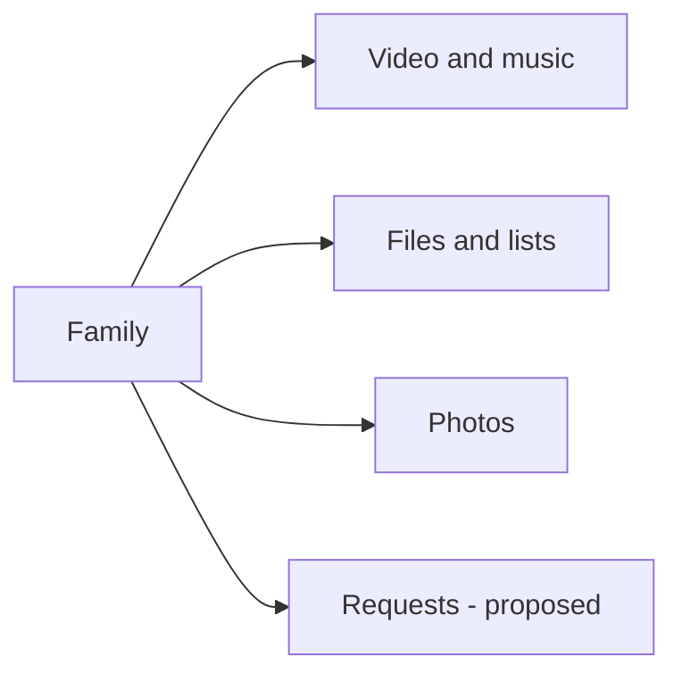
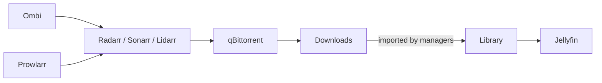
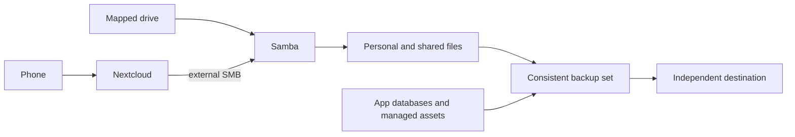

# Independent Astra architecture review

8 November 2026. Source: `ARCHITECTURE_REVIEW.md` v0.2, revision `ac95cf4c95acb19b6b476538cdbb9b1c91f6143e`. Scope: 4–6 users, i5-12500, 16 GB RAM, 1 TB SSD. Planning only; no other review consulted.

## Verdict

Revise before approval. The plan has sound storage ownership, isolation and recovery boundaries, but its default service list exceeds the simplest credible family deployment. **Fewer components can provide a coherent system:** test Jellyfin for music as well as video, Nextcloud Tasks for basic household lists, and Ombi as the single request portal. These are proposed substitutions, conditional on family usability tests. Retain Immich and the required Nextcloud/SMB workflow; replacing either would change the brief.

Use the supplied architecture-review and minimal-change guidance. “Verified” below means documented upstream capability checked during this review; “proposed” means my recommendation. No performance or usability result was measured.

## Ranked findings

1. **High — The default bundle duplicates capabilities (§§1, 3, 10).** Navidrome adds another account store, scanner and backup unit; Mealie introduces a recipe system for a lists requirement. Jellyfin documents music libraries ([upstream](https://jellyfin.org/docs/general/server/media/music/)); Nextcloud Tasks documents task editing and CalDAV clients ([upstream](https://github.com/nextcloud/tasks)). Propose testing these existing services first. Verify offline/background music on actual phones and simultaneous shared-list editing. Retain specialist tools if those journeys fail. Fewer containers alone do not prove easier family use.

2. **High — Music self-service is unresolved (§§6, 12).** An administrator adding an album in Lidarr enables automatic acquisition afterward; it still makes each request depend on administrator availability. The decision table prematurely recommends this compromise. Ombi documents Lidarr, Radarr and Sonarr configuration plus Jellyfin integration ([managers](https://docs.ombi.app/settings/all-the-arrs/), [Jellyfin](https://docs.ombi.app/settings/jellyfin/)). Test Ombi as a replacement for Seerr before adding a separate music frontend. Require a nontechnical user to find the correct album, request it and understand pending, unavailable and failed states without manager access. Catalog matching and present-version compatibility remain unverified.

3. **High — The 16 GB envelope has little demonstrated margin (§§1, 8).** The plan estimates 9.8–14 GiB before extra cache and peaks; its 12 GB development VM cannot validate the upper end. Immich documents 6 GB minimum, 8 GB recommended, and a constrained 4 GB configuration with ML disabled ([requirements](https://docs.immich.app/install/requirements/)). Treat 16 GB as a validation target. Run imports, backup and transcode separately first, then the proposed concurrent workload on the Intel host. Record OOMs, swap, latency and memory pressure. Do not infer transcode capacity from the CPU model or compensate with fragile database limits.

4. **High — Storage protection needs an enforceable first-release boundary (§§5, 6, 9).** Free-space thresholds, queued-byte admission, backup gating and cross-service cleanup imply coordination code. These actions are non-atomic: a crash between unmonitoring, torrent removal and library deletion can leave inconsistent state or reacquisition. Propose manual deletion with a documented reconciliation checklist initially. Bound acquisition storage independently of documents/photos; test quota exhaustion and import copies. Keep one deletion operator and report-only recommendations. Hardlinks reduce duplication only while filesystem and path assumptions hold.

5. **High — SMB-to-phone is a selection gate, not a diagram arrow (§§2, 5, 10).** Keep Samba as file owner and Nextcloud as the supported external-storage client. Upstream verifies SMB support and strongly prefers the PHP SMB module ([documentation](https://docs.nextcloud.com/server/stable/admin_manual/configuration_files/external_storage/smb.html)). Prove Windows create/rename/delete visibility on phones, second-user denial, concurrent edit recovery and backup restoration. A shared privileged SMB credential or directly shared Nextcloud data directory would undermine the boundary. Removing Samba would change the explicit mapped-drive requirement.

6. **Medium — The graph mixes user access, configuration and data movement (§2).** The separate “import” node repeats the managers and can look like another service. Replace the omnibus graph with the three views below. Each component appears once per view; repeated appearances across views describe the same service. Keep databases in the dependency table. Verify comprehension by asking the owner which screen requests an album and which service writes files.

7. **Medium — Public-platform machinery should follow private-use evidence (§§4, 7, 10, 12).** Keep native accounts and explicit configuration. Defer custom provisioning, generalized scheduling, SSO and exhaustive module combinations. A few supported bundles are easier to restore and document. Preserve per-application databases rather than consolidating incompatible dependencies. Keep the independent-backup gate: one SSD cannot recover itself, and restoring images alone cannot reverse schema migrations. A blank-machine restore must include credentials, ACLs, databases and original assets before real family data becomes dependent on this server.

## Keep, remove or defer

All changes below are proposals requiring owner selection.

| Action | Components | Reason / condition |
|---|---|---|
| Keep | Debian, Compose, Caddy, chosen VPN, Restic, disk/backup alerts | Small operational foundation |
| Keep | Jellyfin, Nextcloud + Samba, Immich and required dependencies | Requested playback, files and photos |
| Keep optional | Radarr, Sonarr, Lidarr, qBittorrent, Prowlarr | Automatic movie/TV/music acquisition; centralized indexer configuration earns its place across three managers |
| Replace if tests pass | Seerr → Ombi | One request entry for all three media types |
| Remove from default if tests pass | Navidrome; Mealie | Jellyfin music; Nextcloud Tasks for lists |
| Defer | Homepage service, Bazarr, Uptime Kuma | Start with bookmarks and essential alerts; add subtitles if required by sample playback |
| Defer | Custom PWA, SSO, ML, automatic deletion, public installer | Additional state and maintenance before demonstrated need |

## First release and eventual stack

**Minimal family release:** foundation, Jellyfin, Nextcloud/SMB, Immich with ML disabled, and a validated household-list solution. Include an optional acquisition bundle with one request portal and the five acquisition services above. Automatic acquisition remains in scope; disabled acquisition must leave playback and family data usable. Backups and restore evidence precede production data. Introduce modules sequentially on the same host.

**Eventual stack:** add Navidrome/Substreamer if music testing warrants them, Mealie if recipe/shopping workflows warrant it, and Bazarr if subtitle needs warrant it. Add monitoring history and automation only for observed operational gaps. Publish documented, versioned bundles after another installation reproduces backup and recovery. FOSS licensing and hosted VPN dependency remain explicit decisions.

## Music request choices

| Choice | Benefit | Cost / acceptance |
|---|---|---|
| Ombi for all requests — test first | One family request portal | Validate album search, approvals, Jellyfin users and failed requests |
| Seerr plus separate FOSS music frontend | Preserve movie/TV experience | Extra login/service; frontend selection and maintenance unverified |
| Administrator adds album in Lidarr | Fewest request components | Human queue; requires explicit owner acceptance |

All choices retain automatic search/download/import after approval. No choice establishes reliable single-track acquisition or Hungarian catalog coverage. A custom request form would create authentication, deduplication, status and recovery responsibilities; defer it.

## Three views

Proposed family entry points; Tasks remains subject to household testing:

Acquisition arrows describe requests and work; Prowlarr supplies indexer configuration:

File ownership and recovery; Nextcloud private data remains separate:

## Owner decisions and limits

Select the music request experience, authorize the three consolidation trials, define list membership, and name the backup destination. Confirm subtitle/offline-music requirements, remote-access dependency and TLS ownership. Keep automatic deletion unapproved. Resolve the plan's cooler/case gate before assembly.

No promotional slogans requiring correction were found. No installs, implementation, commits, other-model calls or hardware tests ran. Mermaid was inspected as text, not rendered. Upstream capability checks support the proposed trials; family usability, peak RAM and recovery time remain unmeasured.
