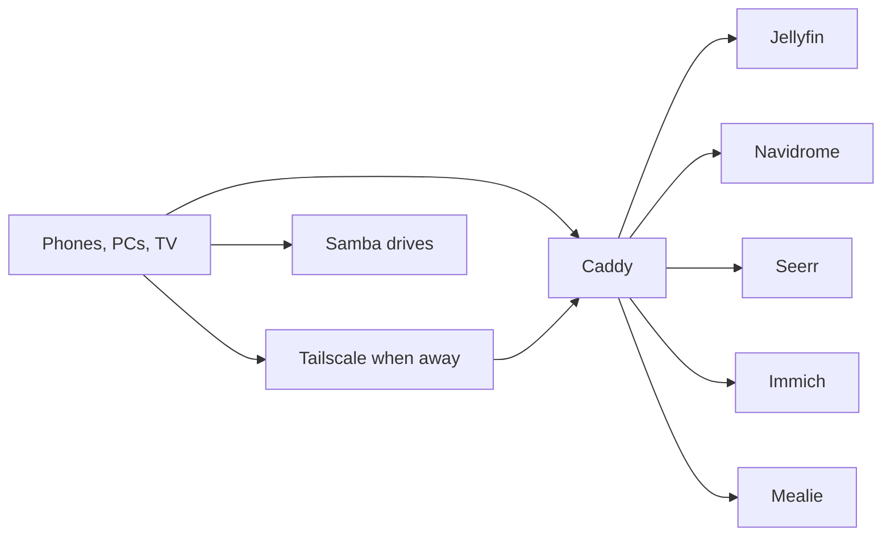
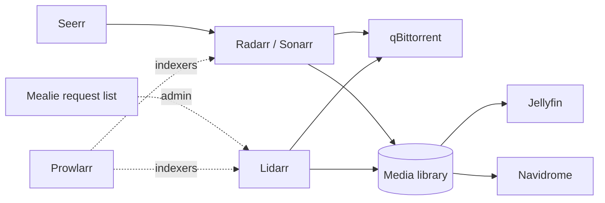
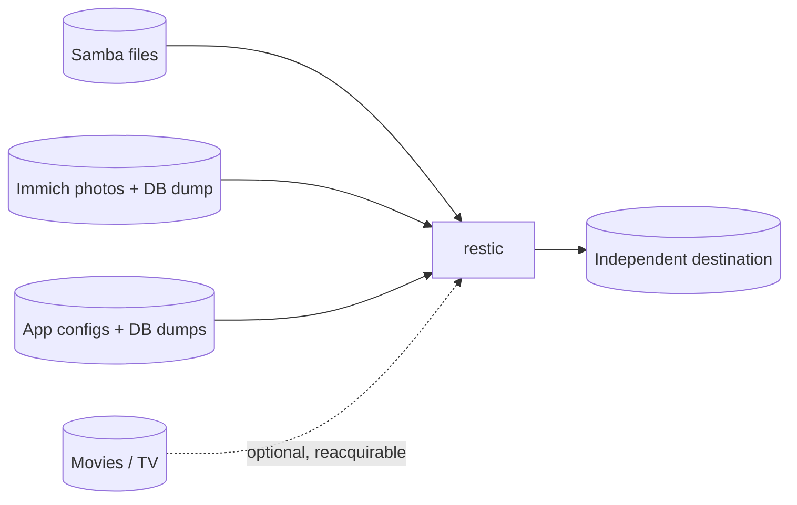

# FamilyHub architecture: independent Opus review

Reviewed: `ARCHITECTURE_REVIEW.md` v0.2, revision ac95cf4, 8 November 2026. Planning only.

Evidence: this pass had no web access. Upstream facts marked **Verified** in the plan were not rechecked. New external claims below are marked **Unverified**. Every component choice is a **proposal**, and nothing has been measured.

## Verdict

The plan is careful and correct in its safety rules, but it does not offer the easiest system. It plans every requested capability at once: about 18 services plus database, cache and ML sidecars, and roughly 8 separate logins per family member. A smaller system can still meet every requirement. It would drop Nextcloud if direct SMB on phones passes a device test, replace Homepage with a static page served by Caddy, defer Bazarr and the monitoring extras, and roll out the rest in three releases. The current diagram is the main reason the plan reads as complicated. It shows services, data stores and pipeline stages as nodes at the same level.

## Ranked findings

1. **Nextcloud plus Samba duplicates the file layer (§3 Files, §5, §9, §11).** The plan has Samba own the files and Nextcloud reach them through SMB external storage. That creates two permission systems, two change-tracking systems, cross-protocol locking gaps, quotas that Nextcloud cannot enforce on SMB writes, and two recovery units that must be stopped together during backups. Its database, cache and cron jobs need about 1.5–2.5 GiB. The stated need is "mapped drive visible on phone". iOS Files can connect to SMB servers, and Android does it through FOSS SMB clients (**Unverified** here, needs a device test). A test over LAN and Tailscale on one iPhone and one Android phone decides this. If it passes, drop Nextcloud. If it fails, keep Nextcloud but make it the only file service and connect Windows to it over WebDAV. Either way, do not run both.

2. **Too many logins for nontechnical users (§7).** Each person gets separate accounts for Jellyfin, Navidrome, Seerr, Nextcloud, Immich, Mealie, Samba and Tailscale. That is 6 users × 8 accounts to create, reset and remove. Every service you remove saves 6 accounts. Seerr can sign users in with their Jellyfin accounts (**Unverified** here). Use that, and give each person one printed sheet listing their accounts and links.

3. **The diagram mixes levels of detail (§2).** Radarr, Sonarr and Lidarr each appear twice: as managers and again as an "import" stage. Databases are separate nodes in some places and missing in others. `STATE` and `MON` are abstract boxes. One flowchart covers access, data flow and backup. Replace it with the three diagrams below, with one node per running service and one question per diagram.

4. **The music request path makes the administrator a bottleneck (§6, §12).** It works, but it is not self-service. See the music request choices below.

5. **No backup destination means no real data (§9, §11).** The plan states this correctly, but it is the gate that matters most. Six recovery units (Immich, Nextcloud, Samba, media, Mealie, host) with separate quiesce steps is too much routine for one administrator. Dropping Nextcloud removes the hardest of them: the consistent pairing of SMB and Nextcloud. Name the backup destination before any other work.

6. **Cleanup changes state in several services without a rollback (§6).** Deleting a title touches Seerr, Radarr or Sonarr, qBittorrent, the hardlinks and Jellyfin, and no step can undo the others. Keeping cleanup report-only is right. Leave Maintainerr and Cleanuparr out of every release until 1 TB actually runs short. Until then, deletion stays a manual action in Radarr or Sonarr.

7. **16 GB fits only by limiting Immich (§8).** The plan's own estimate of 9.8–14 GiB rests on Immich running below its documented 6 GB minimum with ML off. Dropping Nextcloud and Bazarr frees about 2–3 GiB. That margin lets ML run on a schedule later without a RAM purchase.

8. **The development setup adds a second environment to maintain (§1, §10).** The plan uses a 12 GB development VM on a Windows AMD/NVIDIA machine and a separate 16 GB validation profile, while QSV can only be tested on the Intel host. Once the hardware gates pass, use the real host as both validation and production, and keep the VM for Compose and restore drills only.

## Keep, remove or defer

| Component | Decision | Reason |
|---|---|---|
| Debian 13, Docker Compose, Caddy, restic | Keep | Smallest base the plan needs |
| Jellyfin, Navidrome, Substreamer client | Keep | Core playback |
| Samba | Keep | Mapped drives; test it as the phone path too |
| Nextcloud | Remove if the phone SMB test passes, otherwise replace Samba with it | Finding 1 |
| Immich | Keep, release 2 | Needs the backup gate; ML off |
| qBittorrent, Prowlarr, Radarr, Sonarr, Lidarr | Keep as one optional module | Required acquisition. Prowlarr saves configuring indexers three times |
| Seerr | Keep in acquisition module | Self-service movie and TV requests |
| Bazarr | Defer | Add only if Hungarian subtitles are missing from real releases |
| Mealie | Keep, release 3 | Lists required; confirm the one-household limit is enough |
| Homepage | Remove | Replace with one static HTML page from Caddy. One fewer container |
| Uptime Kuma | Keep | Single alert channel |
| Host metrics, Prometheus or Grafana | Defer | smartmontools plus backup-age and free-space alerts are enough |
| Tailscale | Keep for v1 if hosted control is accepted | Headscale later for the FOSS release |
| autobrr, Cleanuparr, Maintainerr | Defer | Finding 6 |

## Minimal first release and full stack

- **Release 1 (files and music):** Caddy, static links page, Samba, Navidrome, Jellyfin, Tailscale, restic to a named destination, Uptime Kuma. The exit test is a restore to a blank VM.
- **Release 1b (acquisition module):** qBittorrent, Prowlarr, Radarr, Sonarr, Lidarr, Seerr.
- **Release 2:** Immich, after the backup gate and memory measurements.
- **Release 3:** Mealie, plus Bazarr only if needed.
- **Full stack and public FOSS release:** add Nextcloud only if the phone test failed, Headscale, cleanup automation, and optional ML.

That is about 14 services at full deployment against about 18 in the plan, with one file-permission system instead of two.

## Music request choices

| Option | Family effort | Admin effort | New components | Assessment |
|---|---|---|---|---|
| A. Ask the admin in person or by message (plan) | Low | Every request | 0 | Not self-service. Requests wait for the admin |
| B. Shared "Music requests" list in Mealie | Low; family already uses it for lists | Copies each item into Lidarr | 0 | Requests are self-service and visible; adding them to Lidarr stays manual |
| C. Lidarr import list from a shared playlist, e.g. ListenBrainz or Spotify | Add album to playlist | Approves monitoring | 0 | Fully automatic. Supported list types and catalogue coverage are **Unverified**. Spotify is proprietary |
| D. Maintained FOSS Lidarr request frontend | Low | Approval only | 1 | Best experience if one exists and is maintained. None verified in this pass |
| E. Custom FamilyHub form calling the Lidarr API | Low | Approval only | Custom code | Adds code FamilyHub must maintain. Last resort |
| F. Lidarr accounts for family | High | Low | 0 | Rejected. Gives family admin access |

Recommendation: start with B for release 1b, because it lets family submit requests without adding a component. Check whether D exists and whether C works, with real Hungarian albums, before considering E.

## Diagrams

Family access (one node per service):

Optional acquisition module:

Data and backup:

## 16 GB and recovery risks

- Immich runs below its documented minimum. Measure it with a real phone upload, not assume it fits.
- A transcode and an import running together can reach the OOM killer. Keep the plan's one-heavy-job rule and its limit of two downloads.
- A single used SSD stays the critical risk. If it fails, no recovery is possible until a backup exists.
- A missing data mount silently redirects writes to the OS disk (§5). Add a startup check that the mount is present.
- Schema migrations cannot be rolled back by changing the image. Keep the plan's rule of a recovery point before each update.

## Owner decisions

1. Does SMB in iOS Files and an Android SMB app count as "mapped drive to phone"? This decides Nextcloud.
2. Which music request option: B, C, or a search for D?
3. Approve the static Caddy page in place of Homepage.
4. Approve deferring Bazarr, autobrr, Cleanuparr, Maintainerr and host metrics.
5. Name the independent backup destination.
6. Accept hosted Tailscale for v1.
7. Approve the release order: 1, 1b, 2, 3.

## Wording check

I found no slogans, no "not just X / more than X" framing and no decorative labels in `ARCHITECTURE_REVIEW.md`. Contrasts such as "Lidarr is a collection acquisition manager, not a streaming player" (§6) are useful clarifications, not slogans.
